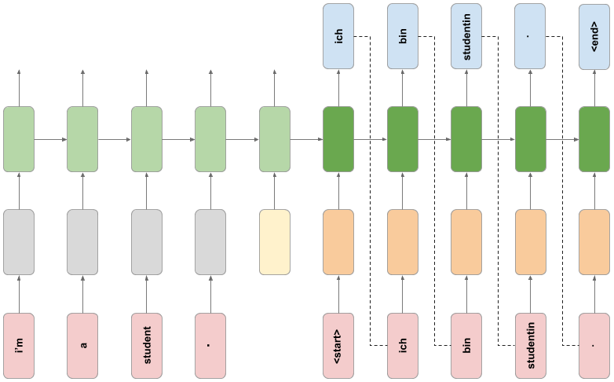

# English to German Neural Machine Translation

An encoder-decoder LSTM built with TensorFlow 2 / Keras that translates short English sentences into German, using a frozen pre-trained English word embedding and a custom training loop.


## Overview

This project builds a sequence-to-sequence translation model from the ground up: clean and tokenize
bilingual text, feed it through a `tf.data` pipeline, build an encoder and a decoder with two
different Keras APIs, train them together with a hand-written training loop and use the trained
model to translate new sentences one word at a time.

The model has **8.44 million trainable parameters** and reaches a best validation loss of **1.58**
after 6 epochs. It learns German structure and common vocabulary well, but it often gets the meaning
wrong, as expected from a small model trained on 40,000 short sentences.

Everything lives in a single notebook: [`tf2-LSTM-neural-machine-translation-english-german.ipynb`](tf2-LSTM-neural-machine-translation-english-german.ipynb)

## Dataset


The English-German sentence pairs of the [Tatoeba / ManyThings](http://www.manythings.org/anki/)
project (`data/deu.txt`), over 200,000 pairs in total. Only the first 40,000 are used:

|  |  |
|---|---|
| Sentence pairs used | 40,000 |
| Training / validation split | 32,000 / 8,000 (random, 80/20) |
| Longest English sentence | 13 words |
| Longest German sentence | 19 tokens (including `<start>` and `<end>`) |
| German vocabulary | 9,071 tokens (9,070 words + padding) |
| Task | sequence-to-sequence translation, English to German |

The file is sorted from shorter to longer sentences, so the first 40,000 pairs are short, everyday
phrases. Preprocessing lowercases the text, transliterates German characters (`ü` to `ue`, `ß` to
`ss`), separates punctuation from the words and keeps only `a-z` and `?.!,'`. The German side also
gets `<start>` and `<end>` tokens.

## Model



### Encoder (Functional API)

| Layer | Configuration | Params |
|-------|---------------|--------|
| Input | 13 words x 128-d pre-trained embeddings (padded with `-1`) | 0 |
| `AddEndToken` (custom) | learned 128-d end token appended to the sequence | 128 |
| `Masking` | ignores the `-1` padding | 0 |
| `LSTM` | 512 units, returns hidden and cell state | 1,312,768 |

**1,312,896 trainable parameters.** The English embedding is a frozen
[TensorFlow Hub module](https://tfhub.dev/google/tf2-preview/nnlm-en-dim128-with-normalization/1)
applied inside the `tf.data` pipeline, so it is not part of the trained weights.

### Decoder (model subclassing)

| Layer | Configuration | Output shape | Params |
|-------|---------------|--------------|--------|
| `Embedding` | learned German embedding, 128-d, `mask_zero=True` | (batch, 19, 128) | 1,161,088 |
| `LSTM` | 512 units, initial state from the encoder | (batch, 19, 512) | 1,312,768 |
| `Dense` | one logit per vocabulary word | (batch, 19, 9071) | 4,653,423 |

**7,127,279 trainable parameters.** Encoder plus decoder: **8,440,175**.

### Training

A custom loop using `tf.GradientTape` with teacher forcing (the decoder input is the German sentence
shifted by one token), `Adam` and `SparseCategoricalCrossentropy(from_logits=True)`. It trains for 10
epochs with batches of 16 sentence pairs.

At inference time the sentence is encoded once and the decoder generates one word at a time (greedy
decoding), feeding its own prediction back until it emits `<end>`.

## Workflow

1. **Load**: the first 40,000 sentence pairs read from `data/deu.txt`.
2. **Preprocess**: text cleaning, `<start>` / `<end>` tokens, Keras `Tokenizer` and zero padding.
3. **Build the pipeline**: `tf.data` datasets that split, embed, filter, pad and batch the English side.
4. **Custom layer**: `AddEndToken`, a learned end-of-sentence embedding.
5. **Encoder and decoder**: Functional API for the encoder, model subclassing for the decoder.
6. **Train**: custom training loop, 10 epochs, with training and validation loss tracked per epoch.
7. **Loss curves**: training vs validation loss plotted per epoch.
8. **Translate**: greedy decoding on sampled dataset sentences and on hand-written ones.

## Results

| Epoch | Train loss | Validation loss |
|------:|-----------:|----------------:|
| 1 | 3.0775 | 2.3591 |
| 4 | 1.1222 | 1.6430 |
| 6 | 0.6376 | **1.5824** |
| 10 | 0.2607 | 1.6697 |

Each epoch took about 13.5 minutes on my machine (around 2 h 15 min in total). Validation loss is
measured on the first 20 validation batches (320 sentences) after every epoch.

Sample translations from the trained model:

| English | Model output | Verdict |
|---------|--------------|---------|
| it's your own fault . | das ist deine eigene schuld . | correct |
| i hailed a cab . | ich habe ein taxi herbeigewinkt . | correct |
| tom was a spy . | tom war ein engel . | fluent but wrong (spy became angel) |
| his name isn't tom . | er hat mir nicht vertraut . | fluent but wrong |
| How are you? | wie geht es dir allen ? | close |
| How old are you? | wie alt sie sie ? | wrong ending |
| I like play soccer | ich mag tennis . | wrong sport |

The first four sentences were sampled at random from the whole dataset, so most of them were also
seen during training; the last three are new sentences.

## Key takeaways

- **The model learns German structure and common vocabulary.** Short, frequent sentences are often
  translated correctly and almost every output is grammatical German.
- **It overfits after epoch 6.** Training loss keeps falling to 0.26 while validation loss rises from
  1.58 to 1.67. The saved weights are the ones from the last epoch, not the best one.
- **Meaning is the weak spot.** Some outputs are fluent but wrong (*spy* became *engel*, *soccer*
  became *tennis*). A single 512-dimensional vector has to carry the whole English sentence, and the
  training data is small.
- **The loss values are only a trend indicator.** The loss includes the padding positions and the
  validation loss uses only 320 sentences, and no BLEU score was computed, so none of this measures
  translation quality precisely.

## Project structure

```
.
├── data/                                                   # Dataset (deu.txt) and the architecture diagrams
├── model/trained_model/                                    # Encoder and decoder weights (not tracked)
├── models/tf2-preview_nnlm-en-dim128_1/                    # Pre-trained English embedding (not tracked)
├── src/tf2_lstm_neural_machine_translation_english_german/ # Package scaffold
├── tf2-LSTM-neural-machine-translation-english-german.ipynb # Main notebook
├── pyproject.toml                                          # Dependencies (uv project)
└── uv.lock                                                 # Pinned versions
```

## Getting started

The project is managed with [uv](https://docs.astral.sh/uv/) and requires Python 3.11+.

```bash
# Clone the repository
git clone https://github.com/ramirezgrosas/tf2-LSTM-neural-machine-translation-english-german.git
cd tf2-LSTM-neural-machine-translation-english-german

# Create the virtual environment and install the dependencies
uv sync
```

Then open the notebook in VS Code and select `.venv` as the kernel, or launch Jupyter directly:

```bash
uv run --with jupyter jupyter lab
```

The dataset (`data/deu.txt`) is included in the repository. The pre-trained embedding and the trained
weights are **not** tracked (see `.gitignore`): download the
[`nnlm-en-dim128-with-normalization`](https://tfhub.dev/google/tf2-preview/nnlm-en-dim128-with-normalization/1)
module from TensorFlow Hub and save it as `models/tf2-preview_nnlm-en-dim128_1/` before running the
notebook. Running the notebook creates `model/trained_model/` with the weights.

Main dependencies: TensorFlow 2.21 (Keras 3.15), TensorFlow Hub, NumPy, scikit-learn and Matplotlib.

## Possible improvements

- Mask the padding positions in the loss, and evaluate on the full validation set with a metric such
  as BLEU.
- Keep the best epoch (or use early stopping) instead of the last weights.
- Add an attention mechanism so the decoder can look at every encoder step instead of a single state
  vector.
- Train on more data (the file has over 200,000 pairs) and add dropout to reduce overfitting.
- Replace greedy decoding with beam search.

## Author

**Diego Ramírez Rosas** — [ramirezgrosas](https://github.com/ramirezgrosas)
